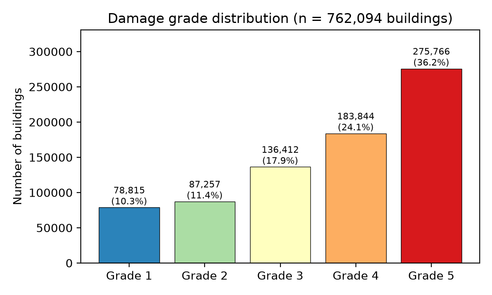
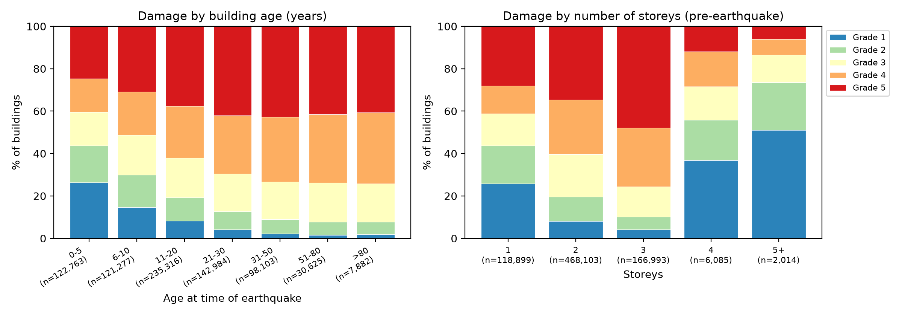
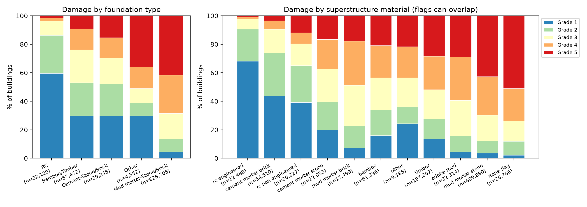
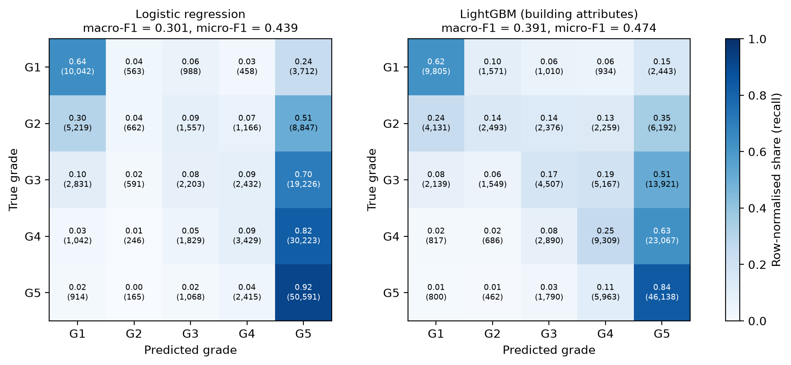
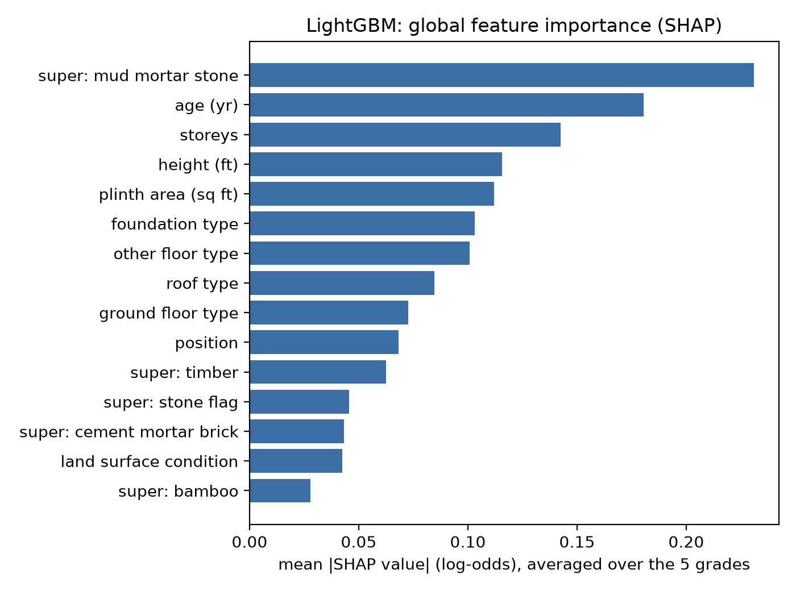
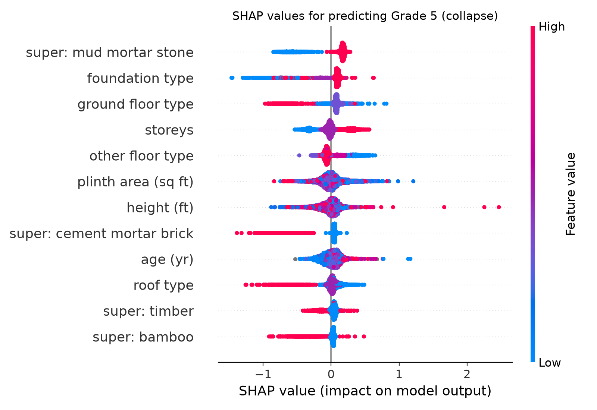
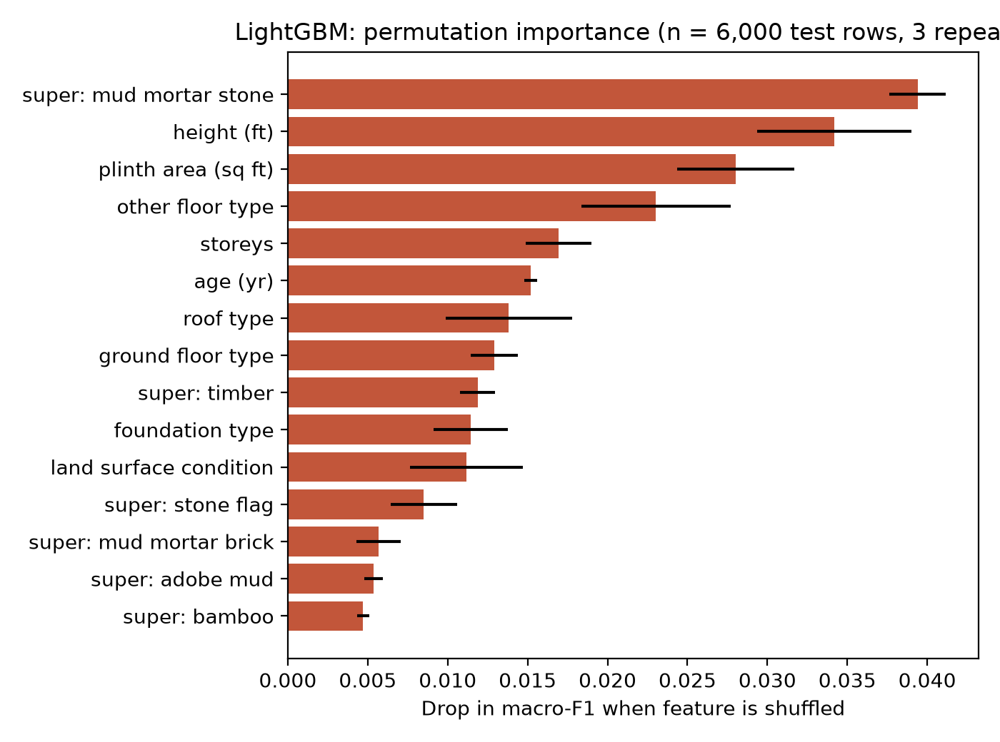

# Predicting earthquake damage grade from building attributes: 2015 Gorkha (Nepal) earthquake

**Author:** Amrish Singh · singhamrish360@gmail.com · ORCID [0009-0005-1584-2504](https://orcid.org/0009-0005-1584-2504)

A small, reproducible machine-learning study. It predicts the post-earthquake **damage grade (1–5)** of
762,094 buildings surveyed after the M7.8 Gorkha earthquake of 25 April 2015. The inputs are only
**pre-earthquake building attributes**: structural system, materials, storeys, age, plan, and so on.
It also checks whether the model's behaviour matches structural-engineering knowledge of seismic
vulnerability.

---

## 1. Problem
Rapid seismic vulnerability screening means ranking large numbers of buildings by how likely they are to be
badly damaged. Inspectors cannot visit every building, so the ranking must come from cheap attributes.
The Nepal post-earthquake census (one of the largest building-damage datasets ever collected) lets us test
how far such attributes go. The task is 5-class classification of the damage grade. Grades 1–5 follow the
survey's EMS-98-style scale, from hairline cracks (Grade 1) to collapse (Grade 5).

## 2. Data
| Item | Detail |
|---|---|
| Dataset | `csv_building_structure.csv`: building-structure table of the *Household Registration for Housing Reconstruction* survey, Government of Nepal (National Planning Commission Secretariat / Central Bureau of Statistics), 11 districts |
| Official source | 2015 Nepal Earthquake Open Data Portal: <https://eq2015.npc.gov.np/#/download> (built by Kathmandu Living Labs, handed over to NPC; legacy URL <http://eq2015.klldev.org>) |
| Copy actually used | The official portal timed out / refused TLS from the build machine (23 Oct 2026). The same CSV was taken from a public GitHub mirror: <https://github.com/bh555/sc1015_z137_grp6/raw/main/csv_building_structure.zip> (commit `31918e5`) |
| Integrity | 762,106 rows × 31 columns. This matches the portal's documented 762,106 buildings. SHA-256 of CSV: `f717ac0fe8ff95a9d84e25b4292a3140ef1255ce77bfc011156593579dfca7fd` (checked automatically by the code) |
| License | The portal describes the data as open and downloadable, but **no explicit license statement could be found**. The GitHub mirror has no license file. Treat it as open government data for **non-commercial research/education with attribution** to the Government of Nepal (NPC/CBS) and Kathmandu Living Labs. The raw data is **not** redistributed in this repo; the code downloads it. |

**Cleaning** (all in `src/eq_damage.py::load_clean`):
* Dropped 4 **post-earthquake / leakage** columns: `count_floors_post_eq`, `height_ft_post_eq`,
  `condition_post_eq`, `technical_solution_proposed`. They are recorded after the event and partly encode the damage itself.
* Dropped 12 rows with a missing damage grade, leaving **762,094** buildings.
* `age_building = 999` (3,144 rows) is a sentinel for unknown age, so it was set to missing.
* Features used (22): storeys, age, plinth area, height (all pre-earthquake); land-surface condition, foundation,
  roof, ground-floor and upper-floor type, position, plan configuration; 11 superstructure-material flags.
  `district_id` is used only in a clearly labelled ablation, because it is a location proxy and not a building attribute.

## 3. Exploratory analysis
| | |
|---|---|
|  |  |



Damage is heavily skewed: 36.2 % of buildings are Grade 5 (collapse) and only 10.3 % are Grade 1.
41.7 % of buildings on **mud-mortar stone/brick foundations** reached Grade 5, against **1.6 %** on RC foundations.
Buildings with an *engineered RC* superstructure flag collapsed in 0.9 % of cases. Those with a
*mud-mortar stone* flag collapsed in 42.7 % (n = 609,880). Damage rises with age and peaks at 2–3 storeys.
At 4+ storeys damage falls again, because about 60 % of those buildings have an RC superstructure flag in this dataset. This is a material
confounder, not evidence that taller is safer.

## 4. Method
* **Split:** stratified 80/20 train/test split (seed 42): 609,675 training and 152,419 test buildings.
  The test set is used once.
* **Cross-validation:** stratified 5-fold CV on a stratified **100,000-row subsample** of the training set
  (subsampled to keep CPU runtime short).
* **Baseline:** multinomial logistic regression (one-hot categoricals, standardised numerics with
  median imputation + missing flag). Trained on a stratified **200,000-row subsample** of the training set
  for runtime/memory.
* **Gradient boosting:** LightGBM (native categorical handling, learning rate 0.1, 63 leaves) trained on the full
  training split minus 10 % used for early stopping (stopped at 742 trees).
* **Ablation:** the same LightGBM model plus `district_id`.
* **Metrics:** macro-F1 (each grade weighted equally; the main metric), micro-F1 (= accuracy for single-label
  data), weighted-F1, and "within ±1 grade" accuracy (useful because grades are ordinal).
* **Interpretability:** SHAP TreeExplainer on 4,000 stratified test rows, and permutation importance
  (drop in macro-F1, 3 repeats) on 6,000 stratified test rows.
* Total runtime of the executed notebook: ~4.3 min on an 8-core CPU.

## 5. Results (held-out test set, n = 152,419)
| Model | Macro-F1 | Micro-F1 (accuracy) | Weighted-F1 | Within ±1 grade |
|---|---|---|---|---|
| Majority class (always Grade 5) | 0.106 | 0.362 | 0.192 | 0.603 |
| Logistic regression | 0.301 | 0.439 | 0.342 | 0.733 |
| **LightGBM (building attributes only)** | **0.391** | **0.474** | **0.426** | **0.781** |
| LightGBM + `district_id` (ablation) | 0.472 | 0.529 | 0.512 | 0.844 |

5-fold CV (100k training subsample, mean ± s.d.): logistic regression macro-F1 0.299 ± 0.002, micro-F1 0.438 ± 0.001;
LightGBM macro-F1 0.371 ± 0.002, micro-F1 0.453 ± 0.003. The CV models saw less data and used 300 trees, which is why they score slightly lower than the test-set models.



**Reading the confusion matrices:** the extremes are recognised best. Grade 5 has 84 % recall and Grade 1 has 62 %.
The intermediate grades 2–4 are mostly confused with their neighbours or pulled towards Grade 5. Logistic regression
almost never predicts Grade 2, while LightGBM spreads its predictions more sensibly. The headline numbers are modest
on purpose, and they are real: building attributes alone cannot see the ground shaking each building experienced.
Adding only the district raises macro-F1 from 0.391 to 0.472.

All numbers come from `results/metrics.json` and `results/test_metrics.csv`, written by the executed notebook.

## 6. Interpretation (plain English)


| | |
|---|---|
|  |  |

* **Mud-mortar stone masonry is the single strongest predictor**, ranking first in both SHAP and permutation
  importance. On average it pushes the Grade-5 (collapse) log-odds up by about +0.17, while its absence pulls them
  down by about −0.58. Mechanically this makes sense. Rubble stone laid in mud mortar has almost no tensile or shear
  strength, walls are thick and heavy (high inertia forces), there are no through-stones or bands tying the wythes
  together, and walls delaminate and collapse out-of-plane.
* **RC and cement-based systems pull predictions towards low damage.** An engineered RC superstructure flag lowers
  Grade-5 log-odds by about −0.97, cement-mortar brick by −0.76, and RC roofs/slabs (−0.64) and RC ground floors (−0.67)
  act the same way. A rigid RC slab gives a diaphragm that ties walls together. Cement mortar gives bond and shear
  capacity. Engineered RC frames provide a defined lateral-load path. *Non-engineered* RC helps much less (−0.25),
  which matches field observations of poorly detailed RC in Nepal.
* **Foundations:** mud-mortar stone/brick foundations raise collapse odds, while RC (−0.58) and bamboo/timber (−0.80)
  foundations lower them. The bamboo/timber effect most likely reflects light-weight timber/bamboo houses, which
  attract low seismic mass. It is not a property of the foundation itself.
* **Age, storeys, height and plinth area** matter next. Older buildings show more damage (material deterioration,
  pre-code construction). For masonry, more storeys and height mean larger overturning demand on weak walls.
  Mixed effects at 4+ storeys reflect RC construction.
* **Caveats on interpretation:** SHAP and permutation importance explain the *model*, not causal physics. Materials
  are correlated with location, wealth and remoteness, which also correlate with shaking intensity. In the beeswarm,
  the colour of categorical features is an arbitrary category code.

## 7. Relevance to India
* **Code context (verified):** under IS 1893 (Part 1):2016, Lucknow lies in seismic **Zone III** (moderate hazard).
  The revised **IS 1893 (Part 1):2025** (BIS, Nov 2025; Zones II–VI) still lists **Lucknow in Zone III** (Annex D,
  Table 18, Z = 0.25 for a 2,475-year return period). Much of the Himalayan belt (e.g. Haridwar, Jammu, Leh,
  Itanagar) is in Zone VI under the 2025 map.
* **Why it transfers:** the building typologies that dominate the Nepal data also make up a large share of Indian
  housing, especially in the Indo-Gangetic plain and Himalayan states. These include unreinforced stone and brick
  masonry in mud or cement mortar, timber/bamboo houses, and non-engineered RC. The 22 attributes used here are the
  kind collected by a census house-listing, a property-tax register, or a quick street survey (storeys, age, wall/roof
  material, foundation, plan shape).
* **How it could be used:** (1) train or recalibrate a model on Indian post-earthquake surveys (e.g. 2001 Bhuj,
  2011 Sikkim, 2016 Imphal) or expert scores. (2) Combine its output with the IS 1893 zone factor or site-specific
  ground-motion estimates. (3) Produce a ward-level ranking of buildings for detailed evaluation and retrofit under
  IS 13935, alongside RVS (rapid visual screening) forms.
* **Limitations:** the model is trained on one earthquake, one region and one survey. Indian construction practice,
  soil conditions (e.g. deep alluvium in Lucknow) and ground motions differ. Labels were assigned in a
  reconstruction-grant survey, which may have incentive bias. There is no explicit hazard input. The model must not be
  used for decisions about individual buildings, and any Indian use needs local validation data.

## 8. Limitations (overall)
* No ground-motion intensity is used (no PGA/MMI per building). `district_id` is only a crude proxy.
* Grades 2–4 are hard to separate (macro-F1 0.39); labels come from non-specialist assessors in some areas.
* Subsampling was used for logistic regression training (200k) and CV (100k) to keep CPU runtime low.
* Hyper-parameters were set by hand with early stopping only, with no extensive tuning.
* Single random split; class imbalance was not re-weighted (macro-F1 could be traded against accuracy with class weights).
* Dataset license is not explicitly stated by the publisher (see §2).

## 9. How to run
**Getting the data.** The raw data (~160 MB) is **not included** in this repository. `src/eq_damage.py` downloads it
automatically from the public GitHub mirror
<https://github.com/bh555/sc1015_z137_grp6/raw/main/csv_building_structure.zip> into `data/raw/`, unzips it and checks the
SHA-256 of `csv_building_structure.csv` (`f717ac0fe8ff95a9d84e25b4292a3140ef1255ce77bfc011156593579dfca7fd`); the run stops
if the hash does not match. To download manually:
```bash
mkdir -p data/raw && cd data/raw
curl -L -o csv_building_structure.zip https://github.com/bh555/sc1015_z137_grp6/raw/main/csv_building_structure.zip
unzip csv_building_structure.zip && sha256sum csv_building_structure.csv   # must equal the hash above
cd ../..
```
The official source is the 2015 Nepal Earthquake Open Data Portal (<https://eq2015.npc.gov.np/#/download>); see §2 for
the license caveat.

**Running the pipeline.**
```bash
python -m venv .venv && source .venv/bin/activate
pip install -r requirements.txt
python src/eq_damage.py            # downloads data, makes figures, trains, writes results/metrics.json
# or open and run the notebook
jupyter nbconvert --to notebook --execute --inplace eq_damage.ipynb
```
The project layout is:
```
eq_damage.ipynb          executed notebook (all outputs)
src/eq_damage.py         full pipeline (data -> EDA -> models -> SHAP/permutation)
results/metrics.json     all metrics, confusion matrices, CV, SHAP summaries
results/test_metrics.csv results table
figures/fig1..fig7       figures used above
Project_Summary.pdf      2-page summary
LICENSE                  MIT license (code only)
```

## 10. Acknowledgements and citation of data
Government of Nepal, National Planning Commission Secretariat & Central Bureau of Statistics. *2015 Nepal
Earthquake: Open Data Portal* (Household Registration for Housing Reconstruction survey), built by Kathmandu Living
Labs. https://eq2015.npc.gov.np. The DrivenData *Richter's Predictor* competition uses a processed subset of
the same survey.

## 11. License
The **code** in this repository (`src/`, the notebook) is released under the [MIT License](LICENSE).
The MIT license does **not** apply to the data. The raw data is not included in this repository; its source and
license status are described in §2 (no explicit license statement was found).
